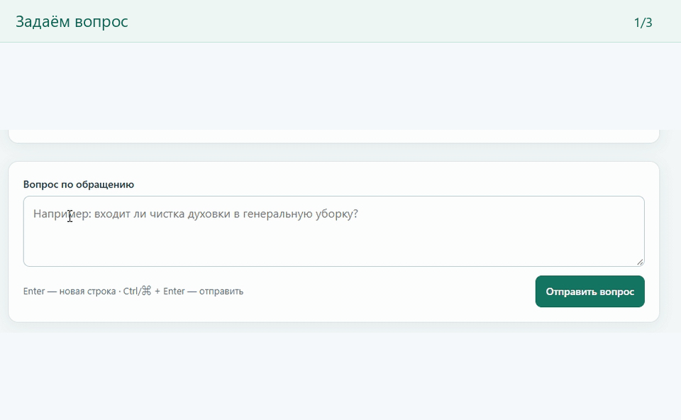
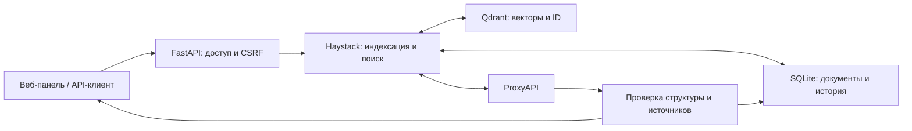

# Cleaning KB Assistant

[](https://github.com/SergeyLT/cleaning-kb-assistant/actions/workflows/ci.yml)

**Веб-помощник менеджера: ответы по документам компании, источники и история обращений.**



Вопрос → ответ → источник → уточнение, которое проверяет сотрудник.

[Быстрый старт](#быстрый-старт) · [API](#api) · [Развёртывание на VPS](#развёртывание-на-vps) · [Тестирование](#тестирование)

## О проекте

Cleaning KB Assistant помогает менеджеру находить состав услуг, условия и ограничения в документах компании, продолжать беседу по одному обращению и готовить итог с источниками.

Ответы формируются по найденным материалам. Если данных недостаточно или источники противоречат друг другу, приложение показывает причину ручного уточнения. Переписка сохраняется в отдельных диалогах; отметка сотрудника фиксирует факт проверки, а её результат остаётся за пределами базы знаний.

Предметная область представлена вымышленной компанией «Демо-клининг». Демонстрационные документы не содержат реальных клиентов, географической привязки или числового прайса.

## Возможности

- База документов: добавление, переименование, просмотр и исключение из поиска.
- Ответы с проверяемыми цитатами и переходом к полному документу.
- Сохраняемые диалоги с контекстом уточнений и отдельными черновиками.
- Очередь ручной проверки с причинами и отметками сотрудника.
- Итоги бесед с источниками, ограничениями и состоянием проверок.
- История операций, журнал действий и JSON-экспорт диалога.
- Просмотр расхода, настройка лимитов и сброс суточных счётчиков с аудитом.
- Адаптивная веб-панель для компьютера и телефона, защищённый JSON API.

## Сценарий работы

1. Добавьте регламент или загрузите демонстрационную базу.
2. Создайте диалог по обращению клиента и задайте вопрос.
3. Раскройте источники: сверьте цитату и при необходимости откройте документ.
4. Продолжите беседу уточнением, например «А духовка туда входит?».
5. Если ответ требует внешнего уточнения, выполните проверку и поставьте отметку.
6. Подведите итог беседы и сохраните результат через JSON-экспорт.

Отметка «проверено» означает факт проверки сотрудником. Она не записывает её результат и не подтверждает автоматически цену, время выезда или назначение исполнителя.

## Стек и архитектура

| Задача | Технология |
|---|---|
| API и валидация | Python 3.12, FastAPI, Pydantic |
| Веб-панель | Jinja2, CSS, JavaScript |
| Индексация и поиск | Haystack, Qdrant, cosine |
| Документы, диалоги и аудит | SQLite |
| Генерация и эмбеддинги | ProxyAPI: GPT-4.1 mini, text-embedding-3-small |
| Проверки | pytest, Ruff, mypy, Playwright Test |
| Поставка | Docker Compose, GitHub Actions, GHCR, Coolify |
| Наблюдаемость | JSON-логи, Alloy, Loki, Grafana |

Зависимости закреплены в [pyproject.toml](pyproject.toml) и [package-lock.json](package-lock.json), контейнеры описаны в [Dockerfile](Dockerfile) и [compose.yml](compose.yml).



SQLite хранит исходные документы и снимки источников; Qdrant — векторы и идентификаторы фрагментов. При каждом вопросе выполняется поиск по активным документам. История помогает понять уточнение, а условия компании подтверждаются найденными материалами.

Приложение проверяет структуру ответа и принадлежность источников. Публичный `confidence` принимает `high`, `medium` или `low`; низкая оценка, недостаток данных и конфликт направляют ответ на проверку. Эта оценка и cosine не являются вероятностью истинности.

Для запуска нужны два контейнера: приложение и Qdrant. Отдельная frontend-сборка не требуется.

## Быстрый старт

Подготовьте [Git](https://git-scm.com/downloads/), работающий Docker с Compose и ключ ProxyAPI с доступом к выбранным моделям и положительным балансом. Установка Docker: [Windows](https://docs.docker.com/desktop/setup/install/windows-install/) · [Linux](https://docs.docker.com/engine/install/). Python и Node на хосте для контейнерного запуска не нужны.

Локальная панель доступна на **http://127.0.0.1:8001/**. Linux и Windows используют один Compose-файл; доступ через домен и HTTPS описан в [маршруте VPS](#развёртывание-на-vps).

### Windows PowerShell

Проверенный маршрут: Windows 11, Windows PowerShell 5.1, Docker Desktop в режиме Linux-контейнеров.

```powershell
git clone https://github.com/SergeyLT/cleaning-kb-assistant.git
cd cleaning-kb-assistant

docker build -t cleaning-kb:local .
docker run --rm -it --user 0:0 --mount "type=bind,source=$($PWD.Path),target=/workspace" --workdir /workspace cleaning-kb:local python -m cleaning_kb init-env
```

Введите пароль менеджера длиной 12–256 символов дважды. Команда создаст `.env` с хешем пароля и случайным API-ключом. Откройте `.env` в редакторе, заполните `PROXYAPI_KEY`, затем запустите:

```powershell
docker compose up -d --wait --wait-timeout 120
Invoke-RestMethod http://127.0.0.1:8001/health
docker compose exec -e APP_BASE_URL=http://127.0.0.1:8000 api python -m cleaning_kb seed
```

### Linux Bash

```bash
git clone https://github.com/SergeyLT/cleaning-kb-assistant.git
cd cleaning-kb-assistant

docker build -t cleaning-kb:local .
docker run --rm -it --user "$(id -u):$(id -g)" --mount "type=bind,source=$PWD,target=/workspace" --workdir /workspace cleaning-kb:local python -m cleaning_kb init-env
```

Введите пароль менеджера длиной 12–256 символов дважды и заполните `PROXYAPI_KEY` в созданном `.env`:

```bash
docker compose up -d --wait --wait-timeout 120
curl -fsS http://127.0.0.1:8001/health
docker compose exec -e APP_BASE_URL=http://127.0.0.1:8000 api python -m cleaning_kb seed
```

### Доступ к панели

Откройте **http://127.0.0.1:8001/** и войдите как `manager` с заданным паролем. `seed` загружает пять документов из [демонстрационного корпуса](docs/demo-company/README.md). Индексация и ответы вызывают платный API.

`/health` проверяет готовность SQLite и Qdrant: ожидается `status=ok` и обе проверки `true`. Доступность ключа и баланс провайдера проверяются при индексации и генерации.

Инициализация `.env` требуется при первой установке; существующий файл команда не перезаписывает. Если порт занят, измените `HOST_PORT` и порт в `APP_BASE_URL`, затем используйте выбранный адрес в запросах. Справочник параметров — [.env.example](.env.example) и [конфигурация](docs/configuration.md).

## API

Операции API защищены `X-API-Key` приложения либо cookie-сессией; изменения через сессию требуют `X-CSRF-Token`. `API_KEY` приложения и `PROXYAPI_KEY` провайдера — разные секреты.

Три основных запроса для Bash после запуска приложения:

```bash
read -rsp 'API_KEY из .env: ' APP_KEY
printf '\n'

curl -fsS http://127.0.0.1:8001/kb/documents \
  -H "X-API-Key: $APP_KEY" -H 'Content-Type: application/json' \
  --data-binary '{"title":"Подготовка духовки","text":"Духовка изнутри заказывается отдельно. Перед чисткой её нужно выключить, остудить и освободить от продуктов и посуды."}'

curl -fsS http://127.0.0.1:8001/kb/ask \
  -H "X-API-Key: $APP_KEY" -H 'Content-Type: application/json' \
  --data-binary '{"question":"Входит ли духовка в генеральную уборку и как её подготовить?"}'

curl -fsS http://127.0.0.1:8001/ai/answer_with_sources \
  -H "X-API-Key: $APP_KEY" -H 'Content-Type: application/json' \
  --data-binary '{"question":"Как подготовить духовку?","context":"Перед чисткой духовку нужно выключить, остудить и освободить от продуктов и посуды."}'

unset APP_KEY
```

Документ возвращает `status=ok`, `document_id` и `indexing_status`; для поиска требуется `ready`. Ответ содержит `answer`, `sources`, `confidence`, `needs_review` и причины проверки. `/ai/answer_with_sources` использует только переданный контекст.

[Контракт и примеры PowerShell с UTF-8](docs/api.md#powershell) · [OpenAPI локального приложения](http://127.0.0.1:8001/docs) — доступен после входа.

### Как воспроизвести ручную проверку

После `seed` запросите точную цену:

```bash
read -rsp 'API_KEY из .env: ' APP_KEY
printf '\n'
curl -fsS http://127.0.0.1:8001/kb/ask \
  -H "X-API-Key: $APP_KEY" -H 'Content-Type: application/json' \
  --data-binary '{"question":"Сколько точно будет стоить генеральная уборка моего помещения?"}'
unset APP_KEY
```

Ожидается `needs_review=true` и причина `price_requires_confirmation`; возможны дополнительные причины. Числового прайса в базе нет, поэтому ответ не должен обещать сумму. Результат доступен в истории и очереди проверки; действие и причина — в аудите.

Тот же вопрос можно задать в диалоге панели или через [PowerShell](docs/api.md#ручная-проверка).

## Конфигурация и данные

| Параметр | Назначение / значение по умолчанию |
|---|---|
| `ADMIN_USERNAME`, `ADMIN_PASSWORD_HASH` | `manager` и обязательный хеш из `init-env` |
| `API_KEY` | Отдельный обязательный ключ приложения |
| `PROXYAPI_KEY` | Ключ провайдера для индексации и ответов |
| `APP_BASE_URL`, `HOST_PORT` | `http://127.0.0.1:8001` и `8001` |
| `GENERATION_MODEL` | `openai/gpt-4.1-mini` |
| `EMBEDDING_MODEL`, `EMBEDDING_DIMENSION` | `openai/text-embedding-3-small`, `1536` |
| `PROVIDER_CALLS_PER_MINUTE`, `PROVIDER_CALLS_PER_DAY` | Начальные лимиты `20` и `200` |
| `PROVIDER_TOKEN_BUDGET_PER_DAY` | Суточный резерв `500000` токенов |
| `DIALOG_MAX_TOKENS`, `SUMMARY_MAX_TOKENS` | Предел диалога с резервом `16000`, генерации итога `2400` |

В разделе «Лимиты» доступны расход, остаток и три настраиваемых порога. Сохранённые значения в SQLite имеют приоритет над начальными переменными окружения. Суточный отсчёт начинается в 00:00 UTC; ручной сброс фиксирует время, учётную запись и прежний расход. История вызовов и фактическая статистика провайдера сохраняются.

Память изолирована по диалогам. При достижении предела нужно начать новый; сжатия истории нет. Сохранённые беседы хранятся до явного удаления, неотправленные черновики — до перезагрузки вкладки. Новый вопрос или отметка сотрудника делают прежний итог неактуальным; все версии итогов доступны в истории.

SQLite находится в `/data/cleaning-kb.sqlite3`, том `app-data`; индекс Qdrant — в `/qdrant/storage`, том `qdrant-data`. Документы доступны в разделе «Документы», результаты и аудит — в «Истории», а также через `GET /history`, `GET /qa/{id}` и `GET /audit`. Для беседы доступен `GET /conversations/{id}/export`.

## Эксплуатация

Журнал приложения и согласованная копия SQLite:

```bash
docker compose logs -f --tail=100 api
docker compose exec api python -m cleaning_kb backup --output /data/backups/snapshot.sqlite3
```

Для каждой копии выбирайте новое имя файла. `docker compose down` сохраняет тома, `docker compose down -v` удаляет данные. Восстановление, обновление и откат описаны в [руководстве эксплуатации](docs/deployment.md#данные-backup-и-восстановление).

Диагностические логи содержат идентификаторы запросов и операций, длительность, статусы и расход. Тексты документов и переписки, пароли и ключи в них не записываются. Для поиска связанных событий используются `request_id` и `operation_id`.

## Развёртывание на VPS

Маршрут поставки: **GitHub Actions → GHCR → Coolify**. Actions проверяет Python и UI, собирает образ с SHA версии и инициирует деплой. Coolify запускает приложение с постоянными томами и публикует HTTPS через прокси.

Для домена настраиваются DNS и привязка к сервису в Coolify; внутренние порты приложения и Qdrant не публикуются на хосте. Подробная инструкция от клонирования до доступа — [GitHub Actions и Coolify](docs/deployment.md).

Для централизованных журналов используются существующие **Loki, Alloy и Grafana**. Конфигурация сбора и готовый dashboard — в [руководстве мониторинга](observability/README.md). Базовый запуск приложения не требует этого стека.

## Тестирование

Для запуска проверок из исходников нужны Python 3.12, а для UI — Node.js 24. Проверки выполняются в отдельном окружении с тестовыми данными.

```powershell
py -3.12 -m venv .venv
.\.venv\Scripts\python.exe -m pip install -e '.[dev]'
.\.venv\Scripts\python.exe -c "from cleaning_kb.budget import prepare_tokenizer; prepare_tokenizer()"
.\.venv\Scripts\python.exe -m ruff check .
.\.venv\Scripts\python.exe -m ruff format --check .
.\.venv\Scripts\python.exe -m mypy src
.\.venv\Scripts\python.exe -m pytest
```

В Linux создайте окружение через `python3.12 -m venv .venv` и выполняйте те же Python-команды через `.venv/bin/python`. `prepare_tokenizer()` загружает словарь в локальный кеш.

UI-проверки:

```powershell
npm ci
$env:PLAYWRIGHT_BROWSERS_PATH = "$PWD/.tmp/ms-playwright"
npx playwright install chromium webkit
npm run test:ui
```

В Bash перед установкой браузеров используйте `export PLAYWRIGHT_BROWSERS_PATH="$PWD/.tmp/ms-playwright"`; для системных зависимостей Linux — `npx playwright install --with-deps chromium webkit`.

Проверяются доступ и CSRF, валидация, источники, отказы провайдера, лимиты, сохранность данных, изоляция диалогов и ревизии итогов. UI-набор покрывает основные сценарии и размеры 375, 768 и 1280 px. Автотесты используют подмену внешнего провайдера и не расходуют платный API.

### Контрольные данные

[Пять документов](docs/demo-company/README.md) представлены в [kb_documents.jsonl](tests_data/kb_documents.jsonl). В [kb_questions.jsonl](tests_data/kb_questions.jsonl) — десять вопросов:

| № | Сценарий | `needs_review` | Основание / документ |
|---|---|---|---|
| 1 | Генеральная и поддерживающая уборка | `false` | Состав работ: 01 |
| 2 | Духовка и подготовка | `false` | Дополнительная опция: 01, 04 |
| 3 | Сведения для расчёта после ремонта | `false` | Порядок сбора данных: 02, 05 |
| 4 | Офис и бумаги на столах | `false` | Работы и ограничения: 03 |
| 5 | Подготовка и доступ | `false` | Общие условия: 05 |
| 6 | Специализированное удаление плесени | `false` | Услуга явно исключена: 04 |
| 7 | Запрос переноса уборки | `false` | Процедура обращения: 05 |
| 8 | Точная цена заказа | `true` | Нет прайса и индивидуального расчёта |
| 9 | Подтверждение бригады завтра | `true` | Нет оперативного расписания |
| 10 | Назначенный сотрудник | `true` | Нет данных конкретного заказа |

Исключённая услуга — подтверждённый отрицательный ответ. Отсутствие цены или назначения требует уточнения; ссылка на общие правила не подтверждает конкретный заказ.

### Качество ответов

Живая оценка запускается отдельно на тестовой базе и вызывает платный API:

```powershell
.\.venv\Scripts\python.exe scripts/evaluate.py --live --env-file .env --cases base01 base02 --output output/quality-evaluation.json
```

Методика, бюджет, негативные документы и содержательная оценка — в [руководстве проверки качества](docs/quality.md). Отчёт с совпавшими цитатами не заменяет проверку смысла ответа.

## Границы и развитие

Приложение рассчитано на одну общую учётную запись и один экземпляр сервера с локальной SQLite. Проверяемая цитата не гарантирует правильность вывода модели; конфликт вне найденных фрагментов может остаться незамеченным.

Возможные направления развития:

- Персональные учётные записи и права на обращения.
- Сохранение результата внешней проверки и его истории.
- Управляемое сжатие длинных бесед.
- Группировка выдержек одного документа и расширение оценки поиска.

## Лицензия и автор

[MIT](LICENSE) · [SergeyLT](https://github.com/SergeyLT)
