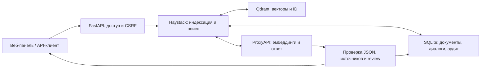

# Cleaning KB Assistant

[](https://github.com/SergeyLT/cleaning-kb-assistant/actions/workflows/ci.yml)

Поиск по материалам компании и ответы с проверяемыми источниками для менеджера.

Веб-панель для ПК и телефона объединяет базу знаний, ответы через ProxyAPI, сохраняемые диалоги, отметки проверки, итоги бесед и историю. Для автоматизации доступен защищённый JSON API.

## О проекте

Менеджеру клининговой компании нужно быстро находить состав услуг, ограничения и условия обслуживания. Помощник предназначен для подготовки ответа по внутренним документам с цитатами, которые сотрудник может проверить перед общением с клиентом.

Предметная область представлена вымышленной компанией и демонстрационными материалами.

## Возможности

- Добавление и просмотр документов базы знаний.
- Исключение устаревших документов и повтор индексации после сбоя.
- Переименование документов без повторной индексации; актуальные названия в источниках.
- Ответы по найденным фрагментам с проверяемыми цитатами.
- Видимые причины необходимости ручного уточнения.
- Сохранение результатов обработки, аудит и лимиты обращений к модели.
- Просмотр расхода, настройка лимитов и сброс суточных счётчиков с историей действий.
- Изолированные диалоги с памятью уточнений, переименованием и удалением.
- Очередь проверки и отдельная отметка сотрудника без изменения исходного ответа.
- Итог всей беседы с источниками и состояниями проверки, история и JSON-экспорт.

Интерфейс использует серверные шаблоны и небольшой JavaScript; отдельная frontend-сборка для запуска не нужна.

Ответы предназначены для менеджера. Помощник не подтверждает окончательную стоимость и доступность бригад, не оформляет заказы и не отправляет сообщения клиенту.

## Демонстрационные материалы

[База знаний «Демо-клининг»](docs/demo-company/README.md) содержит пять собственных регламентов вымышленной компании: услуги для квартир, уборка после ремонта, офисы, дополнительные работы и порядок обслуживания. Материалы не привязаны к стране или городу и не содержат реальных клиентов, контактов и числового прайса.

[Контрольные данные](tests_data/README.md) включают документы в JSONL и десять вопросов с ожидаемыми результатами. Загрузка идемпотентна: повтор не создаёт документов и не пересчитывает готовые эмбеддинги.

## Стек

| Задача | Технология |
|---|---|
| API и строгие контракты | Python 3.12, FastAPI, Pydantic |
| Веб-интерфейс | Jinja2, CSS, JavaScript; без frontend-сборки |
| Индексация и поиск | Haystack pipelines, Qdrant |
| Документы, диалоги и аудит | SQLite, стандартный sqlite3, SQL-миграции |
| Генерация и эмбеддинги | ProxyAPI: openai/gpt-4.1-mini, openai/text-embedding-3-small |
| Проверки | pytest, Ruff, mypy, Playwright Test |
| Поставка и журналы | Docker Compose, GitHub Actions, GHCR, Coolify; Alloy → Loki → Grafana |

Прямые Python-зависимости закреплены в [pyproject.toml](pyproject.toml), UI-инструменты — в [package-lock.json](package-lock.json), базовые образы — по версии и digest. Данные и векторы хранятся рядом с приложением, модели вызываются через внешний API.

## Архитектура



Документы являются источником условий компании. История диалога помогает понять уточнение; при каждом вопросе поиск выполняется заново. Прежние ответы и итоги не добавляются автоматически в базу знаний.

## Быстрый старт

Нужны Git, Docker Engine с Compose v2 и доступ к сети; на Windows — Docker Desktop с Linux-контейнерами. Для ответов и первой индексации нужен ключ ProxyAPI с доступом к выбранным моделям и положительным балансом. Python и Node на хосте для контейнерного запуска не требуются.

Целевой запуск — до 10 минут при заранее подготовленных инструментах и ключе. Установку Docker и получение ключа учитывают отдельно. Холодный запуск включает клонирование, сборку, настройку, загрузку корпуса и первый ответ. Независимые замеры Windows/Linux пока не подтверждены; время зависит от сети и провайдера.

### Windows PowerShell

```powershell
git clone https://github.com/SergeyLT/cleaning-kb-assistant.git
cd cleaning-kb-assistant
docker build -t cleaning-kb:local .
docker run --rm -it --user 0:0 --mount "type=bind,source=$($PWD.Path),target=/workspace" --workdir /workspace cleaning-kb:local python -m cleaning_kb init-env
```

Откройте созданный `.env` в редакторе и заполните `PROXYAPI_KEY` своим ключом. Затем:

```powershell
docker compose up -d --wait --wait-timeout 120
Invoke-RestMethod http://127.0.0.1:8001/health
docker compose exec -e APP_BASE_URL=http://127.0.0.1:8000 api python -m cleaning_kb seed
```

`init-env` дважды запросит пароль менеджера, сохранит только его хеш и создаст случайный API-ключ. Логин — `manager`, длина пароля — 12–256 символов. Существующий `.env` не перезаписывается: при повторном запуске пропустите эту команду.

```powershell
$apiKey = Read-Host 'Введите API_KEY из локального .env'
Invoke-RestMethod -Uri http://127.0.0.1:8001/api/status -Headers @{ 'X-API-Key' = $apiKey }
Remove-Variable apiKey
```

### Linux Bash

```bash
git clone https://github.com/SergeyLT/cleaning-kb-assistant.git
cd cleaning-kb-assistant
docker build -t cleaning-kb:local .
docker run --rm -it --user "$(id -u):$(id -g)" --mount "type=bind,source=$PWD,target=/workspace" --workdir /workspace cleaning-kb:local python -m cleaning_kb init-env
```

Заполните `PROXYAPI_KEY` в созданном `.env`, затем:

```bash
docker compose up -d --wait --wait-timeout 120
curl -fsS http://127.0.0.1:8001/health
docker compose exec -e APP_BASE_URL=http://127.0.0.1:8000 api python -m cleaning_kb seed
```

Для существующего `.env` пропустите `init-env`. Проверка закрытой операции:

```bash
read -rsp 'Введите API_KEY из локального .env: ' APP_KEY
curl -fsS http://127.0.0.1:8001/api/status -H "X-API-Key: $APP_KEY"
unset APP_KEY
```

Успешный `/health` возвращает `status=ok`, версию и проверки `sqlite=true`, `qdrant=true`. Если порт занят, измените одновременно `HOST_PORT` и порт в `APP_BASE_URL`, затем используйте новый адрес в запросах. Compose ограничивает доступ адресом `127.0.0.1`.

`seed` загружает пять вымышленных документов; первая загрузка вызывает платный API эмбеддингов. Ключ и баланс модели не проверяются health-запросом. Без ключа сервер запускается, но индексация завершается состоянием `failed` с кодом `provider_not_configured`. После настройки ключа повторите `seed` или индексацию нужного документа.

Команда `exec -e APP_BASE_URL=...` задаёт адрес только процессу загрузки внутри контейнера: сервер остаётся настроен на внешний локальный порт. Собственный JSONL можно передать параметром `seed --input <путь>`; каждый объект должен иметь только `title` и `text`.

Откройте [панель на localhost](http://127.0.0.1:8001/) и войдите с логином и паролем из настройки `init-env`. `/docs` и `/openapi.json` защищены тем же доступом, что API; после входа они доступны в браузере. Ключ API принимается в заголовке, а не в URL.

## Сценарий в веб-панели

1. В разделе «Документы» добавьте название и текст либо загрузите демодокументы командой `seed`.
2. В «Диалогах» нажмите «Новый диалог» и задайте вопрос. Под ответом раскройте источники и при необходимости откройте полный документ.
3. Продолжите уточнением, например «А духовка туда входит?». Для другого обращения создайте отдельную беседу.
4. Если ответ требует уточнения, причина видна на карточке. После проверки нажмите «Отметить проверенным»: исходная причина сохраняется.
5. Кнопка «Подвести итог» внизу беседы создаёт снимок с источниками и состояниями проверки; после создания открывается новый итог. Его можно скопировать; после новых сообщений или отметок прежний итог помечается устаревшим. Кнопки «К началу диалога» и «К концу диалога» позволяют перейти между шапкой и полем вопроса.
6. В «Истории» доступны результаты, фильтр непроверенных и журнал действий. Из диалога доступен JSON-экспорт; удаление требует подтверждения.

На телефоне список и беседа открываются отдельно; кнопка «Все диалоги» возвращает к списку. Источники раскрываются под ответом. Enter добавляет строку, Ctrl/⌘+Enter отправляет вопрос. Черновики разных бесед сохраняются при переключении внутри вкладки, при ошибке и при отказе из-за лимита. Перезагрузка/закрытие вкладки сбрасывает неотправленные черновики; сохранённая переписка остаётся в базе. Во время обработки повторная отправка блокируется. После неизвестного сетевого результата сначала проверьте историю, прежде чем повторять запрос.

## API и доступ

В разделе «Лимиты» показаны вызовы за минуту и сутки, использованный резерв токенов и отдельно фактический usage, полученный от провайдера. Три порога сохраняются в SQLite и применяются без перезапуска. Переменные окружения задают начальные значения; после первого сохранения приоритет имеют настройки из панели.

«Сбросить суточные счётчики» начинает новый отсчёт до ближайших 00:00 UTC. Минутное ограничение, история вызовов и фактический usage сохраняются. При незавершённых операциях сброс блокируется. Время, учётная запись и прежние значения доступны в журнале; при общей учётной записи определить конкретного человека невозможно. Операция не меняет баланс у провайдера.

Переименование меняет только название документа. В карточках источников и подписях итогов отображается текущее название, а исходные тексты и названия снимков сохраняются для истории. Защищённый JSON-экспорт версии 2 дополнен `current_title` источников и `display_text` итогов; исходные `title`, `text` и `answer` не переписываются.

| Операция | Назначение |
|---|---|
| GET /live, GET /health | Проверка процесса и готовности SQLite/Qdrant |
| POST /kb/documents | Добавление документа и попытка индексации |
| PATCH /kb/documents/{id} | Переименование документа без вызова модели |
| GET /settings/provider, PUT /settings/provider | Расход и сохранение трёх порогов |
| POST /settings/provider/reset | Подтверждённый сброс суточных счётчиков |
| POST /kb/ask | Ответ по базе знаний с источниками |
| POST /ai/answer_with_sources | Строгий ответ только по переданному контексту |
| GET /history, GET /qa/{id} | История и детали обработки |
| GET /audit | Журнал действий и ошибок |
| GET /conversations/{id}/export | JSON-экспорт беседы |

Защищённые операции требуют отдельный API_KEY приложения либо cookie-сессию. Изменения с cookie требуют X-CSRF-Token. Ключ провайдера не является ключом приложения. Веб-панели API-ключ не нужен.

### Linux Bash

Прочитайте API_KEY из локального .env без отображения на экране. Добавление документа и генерация ответов расходуют платный API.

```bash
read -rsp 'API_KEY из локального .env: ' APP_KEY

curl -fsS http://127.0.0.1:8001/kb/documents \
  -H "X-API-Key: $APP_KEY" -H 'Content-Type: application/json' \
  --data-binary '{"title":"Подготовка духовки","text":"Духовка изнутри заказывается отдельно. Перед чисткой её нужно выключить, остудить и освободить от продуктов и посуды."}'

curl -fsS http://127.0.0.1:8001/kb/ask \
  -H "X-API-Key: $APP_KEY" -H 'Content-Type: application/json' \
  --data-binary '{"question":"Входит ли духовка в генеральную уборку и как её подготовить?"}'

curl -fsS http://127.0.0.1:8001/ai/answer_with_sources \
  -H "X-API-Key: $APP_KEY" -H 'Content-Type: application/json' \
  --data-binary '{"question":"Как подготовить духовку?","context":"Перед чисткой духовку нужно выключить, остудить и освободить от продуктов и посуды."}'

unset APP_KEY
```

Документ возвращается с `status="ok"`, `document_id`, совместимым полем `id`, `is_active` и `indexing_status`. Статус `ok` означает сохранение документа; при ошибке индексации он остаётся сохранённым с `indexing_status="failed"` и кодом `error`. Для поиска требуется `indexing_status="ready"`. Ответ на вопрос содержит `operation_id`, `answer`, `sources`, `confidence` (`high` / `medium` / `low`), `needs_review` и `review_reasons`. Низкая категория всегда требует проверки; высокая не отменяет другие причины уточнения. У обычного ответа по базе источники непустые; у переданного контекста `document_id=null`.

### Как воспроизвести ручную проверку

После seed выполните в PowerShell:

```powershell
$apiKey = Read-Host 'API_KEY из локального .env'
$headers = @{ 'X-API-Key' = $apiKey }
$body = @{ question = 'Сколько точно будет стоить генеральная уборка моего помещения?' } | ConvertTo-Json
$result = Invoke-RestMethod http://127.0.0.1:8001/kb/ask -Method Post -Headers $headers -ContentType 'application/json; charset=utf-8' -Body ([Text.Encoding]::UTF8.GetBytes($body))
$result | ConvertTo-Json -Depth 8
Invoke-RestMethod "http://127.0.0.1:8001/qa/$($result.operation_id)" -Headers $headers
Remove-Variable apiKey, headers
```

Ожидается needs_review=true и причина price_requires_confirmation (возможны дополнительные причины), без выдуманной суммы. Ответ виден в истории и фильтре «Требуют проверки». Эквивалент Bash — запрос /kb/ask выше с заменой question на вопрос о точной цене.

[Полный контракт и все три PowerShell-примера](docs/api.md) включают документы, диалоги, отметки, итоги и экспорт.

## Как формируется ответ

SQLite хранит исходные документы, фрагменты и состояния. Haystack связывает отдельные компоненты индексации и поиска. Qdrant хранит векторы и идентификаторы без копий текста. До завершения записи документ не участвует в поиске; исключённые документы фильтруются по SQLite. При смене модели/размерности используется другая коллекция и требуется повторная индексация документов.

Модель получает ограниченный набор выдержек и выбирает их идентификаторы в строгом JSON. Приложение проверяет схему и принадлежность источников, а цитаты берёт из SQLite. Старые ответы содержат снимки источников. Недостаток данных, частичное покрытие, противоречие и низкая уверенность отмечаются `needs_review=true` с причинами. Cosine не является вероятностью правильности ответа.

Допускается одна дополнительная генерация для исправления формата или неверных ссылок. При сетевой ошибке платный запрос автоматически не повторяется. Проверка подлинности цитат не доказывает, что каждая фраза ответа логически следует из них; контроль качества и ручная проверка остаются необходимы.

## Конфигурация

[.env.example](.env.example) перечисляет поддерживаемые поля без секретов. Для запуска используйте init-env, а не пустые значения примера. Переменные окружения имеют приоритет над файлом. Не публикуйте .env и полный вывод docker compose config: он содержит подставленные секреты.

| Переменная | Назначение / по умолчанию |
|---|---|
| ADMIN_USERNAME, ADMIN_PASSWORD_HASH | manager и обязательный хеш из init-env |
| API_KEY | Обязательный отдельный ключ приложения |
| PROXYAPI_KEY | Ключ внешнего провайдера для индексации/ответов |
| APP_BASE_URL, HOST_PORT | http://127.0.0.1:8001 и 8001; production требует HTTPS |
| APP_ENVIRONMENT | local, test или production |
| GENERATION_MODEL | openai/gpt-4.1-mini; поддержка строгого JSON |
| EMBEDDING_MODEL, EMBEDDING_DIMENSION | openai/text-embedding-3-small, 1536 |
| PROVIDER_CALLS_PER_MINUTE, PROVIDER_CALLS_PER_DAY | Общие сохраняемые лимиты: 20 и 200 |
| PROVIDER_TOKEN_BUDGET_PER_DAY | Консервативный резерв 500000 токенов, не денежная сумма |
| DIALOG_MAX_TOKENS, SUMMARY_MAX_TOKENS | История с резервом 16000, генерация итога 2400 |

Таймауты, поиск, доступ, размеры и все значения описаны в [справочнике конфигурации](docs/configuration.md). Суточные лимиты — по UTC; неудачные/прерванные вызовы тоже занимают резерв, поскольку списание могло произойти. Денежный предел дополнительно настройте у провайдера.

## Работа с диалогом

Создайте диалог запросом `POST /conversations` с `{}` либо `{"title":"Обращение клиента"}`. В последующие запросы `/kb/ask` добавляйте `conversation_id`. Например, после вопроса о генеральной уборке можно спросить «А духовка туда входит?». Для продолжения модель формирует отдельный поисковый вопрос по всей истории, затем приложение заново ищет документы. Переписка другого диалога в запрос не попадает, предыдущие итоги из памяти исключены. Это дополнительный платный запрос при продолжении.

Токенизатор `o200k_base` считает вопросы, ответы, состояния и снимки цитат. До обращения к провайдеру резервируются следующий ответ, максимальные доступные источники и служебные поля. Старые сообщения не обрезаются и не сжимаются. Объект `budget` сообщает расход, резерв, предупреждение и `can_ask`. При переполнении сервер возвращает HTTP 409 до платного вызова; новый вопрос не сохраняется как отправленный. Просмотр, отметки и итог остаются доступны. Словарь токенизатора включён в Docker-образ; локальный Python при первом использовании загружает его в `.tmp/tiktoken/`.

`needs_review` и исходные причины неизменны. Отдельный `reviewed_at` означает только факт выполненной проверки/уточнения: её результат не записывается. Такая отметка не подтверждает цену, выезд и назначение сотрудника. Итог содержит сведения со слов пользователя, выводы по сохранённым источникам, ограничения и фактические отметки из БД. Поле `text` предназначено для копирования. Модель не получает отметки сотрудника и не определяет их.

Новый вопрос или отметка делают старый итог устаревшим (`is_stale=true`). Обновление создаёт новый снимок и сохраняет предыдущий. Пока в диалоге выполняется ответ или итог, второй запрос и изменения возвращают HTTP 409. Разные диалоги обрабатываются независимо в пределах общего лимита операций.

Диалоги хранятся до явного удаления. `DELETE /conversations/{id}?confirm=true` удаляет беседу, ответы, итоги и связанный аудит, оставляя технический факт удаления. Документы и обезличенный учёт платных вызовов сохраняются: удаление не сбрасывает бюджет. Это удаление записей приложения, а не гарантия стирания из SQLite WAL и резервных копий; политика backup определяется при настройке развёртывания.

## Данные и диагностика

Один экземпляр приложения использует одну локальную SQLite; файловая блокировка предотвращает второй процесс на той же БД. Несколько реплик и сетевые файловые системы не поддерживаются.

SQLite хранится в томе `app-data`, индекс Qdrant — в `qdrant-data`. Фактические имена volumes зависят от имени Compose-проекта. `docker compose down` сохраняет данные; `docker compose down --volumes` удаляет данные этого экземпляра.

```sh
docker compose ps
docker compose logs --tail=100 api
docker compose exec api python -m cleaning_kb backup --output /data/backups/snapshot.sqlite3
```

Для backup выбирайте новое имя: существующий файл не перезаписывается. Восстановление и откат описаны в [production-руководстве](docs/deployment.md#данные-backup-и-восстановление). Для просмотра результатов и аудита используйте «Историю»/журнал панели, `GET /history`, `GET /qa/{id}` и `GET /audit`. Беседу можно выгрузить через `GET /conversations/{id}/export`.

`X-Request-ID` связывает события одного запроса, `operation_id` — этапы RAG и вызовы провайдера. Документы, сообщения, пароли, cookies и ключи не записываются в диагностические логи. Docker ограничивает журнал тремя файлами по 10 МБ на контейнер.

SQLite содержит таблицы `documents`, `snippets`, `conversations`, `qa_runs`, `audit_runs`, `auth_sessions`, `provider_calls` и `schema_migrations`. Вход, выход и операции базы знаний оставляют технический аудит без реквизитов. В `qa_runs` сохраняются вопросы, проверенные результаты и снимки цитат; в `provider_calls` — модель, резерв и usage без текстов. Сессии сохраняются между перезапусками и отзываются сервером при выходе. После аварийного завершения незаконченные операции помечаются прерванными; автоматического повторного списания нет.

## Проверки

На Windows:

```powershell
py -3.12 -m venv .venv
.\.venv\Scripts\python.exe -m pip install -e '.[dev]'
.\.venv\Scripts\python.exe -c "from cleaning_kb.budget import prepare_tokenizer; prepare_tokenizer()"
.\.venv\Scripts\python.exe -m ruff check .
.\.venv\Scripts\python.exe -m ruff format --check .
.\.venv\Scripts\python.exe -m mypy src
.\.venv\Scripts\python.exe -m pytest
```

На Linux создайте окружение через `python3.12 -m venv .venv` и выполняйте те же проверки через `.venv/bin/python`. Предварительный `prepare_tokenizer()` один раз скачивает словарь в `.tmp/tiktoken/`; в Docker он уже включён в образ. После подготовки кеша тесты не требуют внешних сервисов и не вызывают платную модель. Временные данные pytest находятся в `.tmp/pytest`.

Проверяются доступ, CSRF, отзыв сессий, миграции, безопасные логи, кеш и повтор индексации, источники и причины review, атомарные лимиты, изоляция памяти, предел беседы, конкурирующие изменения, ревизии итогов, отметки, удаление связанных данных и HTML-панель. Живой прогон на своих ключах оплачивается отдельно и не запускается командой pytest. Методика живой оценки качества приведена ниже; платные прогоны отделены от автотестов.

### Контрольные вопросы

[Пять документов](docs/demo-company/README.md) синхронизированы с [kb_documents.jsonl](tests_data/kb_documents.jsonl). В [kb_questions.jsonl](tests_data/kb_questions.jsonl) десять вопросов с ожидаемым результатом:

| № | Предмет вопроса | expected_needs_review | Почему / документ |
|---|---|---|---|
| 1 | Генеральная и поддерживающая уборка | false | Состав обоих видов описан, 01 |
| 2 | Духовка и подготовка | false | Отдельная опция, условия известны, 01 и 04 |
| 3 | Сведения для расчёта после ремонта | false | Известный порядок сбора данных, 02 и 05 |
| 4 | Офис и бумаги на столах | false | Работы и ограничения описаны, 03 |
| 5 | Подготовка и доступ | false | Условия перечислены, 05 |
| 6 | Специализированное удаление плесени | false | Услуга прямо исключена, 04 |
| 7 | Сведения для запроса переноса | false | Известна процедура, 05 |
| 8 | Точная цена моего заказа | true | Нет прайса и индивидуального расчёта |
| 9 | Подтверждение бригады завтра | true | Нет оперативного расписания |
| 10 | Назначенный сотрудник | true | Нет данных конкретного заказа |

Первые семь ответов должны содержать подходящие источники. В последних трёх допустима ссылка на правило уточнения, но она не подтверждает отсутствующий факт. Подтверждённый отрицательный ответ об исключённой услуге отличается от отсутствия сведений.

### Качество ответов

Для отдельного стенда с загруженной демонстрационной базой предусмотрено 18 контрольных случаев. После установки Python-окружения можно явно запустить платную оценку:

```powershell
.\.venv\Scripts\python.exe scripts/evaluate.py --live --env-file .tmp/quality.env
```

В `.tmp/quality.env` укажите адрес и ключи именно тестового экземпляра; формат переменных тот же, что в `.env.example`. На Linux используйте `.venv/bin/python`. Для ограниченного повтора добавьте, например, `--cases base02 crew_paraphrase`. Без `--live` запросы не выполняются. Полный набор временно добавляет негативные документы, поэтому требует отдельной базы. Отчёт сохраняется в `output/quality-evaluation.json`; регулярные pytest не обращаются к модели.

Отчёт фиксирует фактические модели и версию промпта сервера, ответы, проверки, источники и usage. После автоматической оценки нужен содержательный разбор: подлинная цитата сама по себе не гарантирует правильности вывода. Ограничения и порядок разбора — в [методике качества](docs/quality.md).

### UI-тесты

Для разработки нужны Node.js и npm (проверено с Node 24.15 и npm 11.12). После подготовки Python-окружения и словаря:

```powershell
npm ci
$env:PLAYWRIGHT_BROWSERS_PATH = Join-Path $PWD '.tmp/ms-playwright'
npx playwright install chromium webkit
npm run test:ui
```

На Linux:

```bash
npm ci
PLAYWRIGHT_BROWSERS_PATH="$PWD/.tmp/ms-playwright" npx playwright install --with-deps chromium webkit
npm run test:ui
```

`--with-deps` на Linux устанавливает системные зависимости браузеров и может потребовать права администратора. Node и браузеры не нужны для обычного запуска приложения через Compose. Версия Playwright Test закреплена в `package-lock.json`; конфигурация — [playwright.config.ts](playwright.config.ts). При занятом порте `8877` задайте `UI_TEST_PORT`.

Шесть коротких сценариев проверяют desktop Chromium, mobile WebKit и компоновку 375×812 / 768×1024 / 1280×800. Test runner запускает отдельное приложение с настоящими HTTP, SQLite, сессиями, CSRF и сервисами; модель и векторное хранилище подменены только в серверном тестовом модуле. Отдельный сценарий ошибок/лимита дополнительно подменяет ответы в браузере. Платный API не вызывается, тестовые данные не подмешиваются в рабочую базу. Отчёт, screenshots ошибок и traces находятся в `.tmp/playwright/`; автоматических локальных повторов нет. Мобильная эмуляция не заменяет проверку реального телефона.

## Production и мониторинг

Для VPS предусмотрен маршрут **GitHub Actions → GHCR → Coolify**: проверки Python/UI, готовый образ с SHA версии, постоянные тома и HTTPS через прокси. Автодеплой включается после первичной настройки; успешность проверяется по health и ожидаемому SHA.

Подробности, секреты, домен, backup и откат — в [руководстве развёртывания](docs/deployment.md). [Конфигурация Alloy и dashboard Grafana](observability/README.md) подключаются к существующему Loki/Alloy/Grafana; установка этих компонентов отдельно не описывается.

## Ограничения и развитие

Одна общая учётная запись даёт доступ ко всем беседам, персональных ролей нет. Приложение рассчитано на один экземпляр с локальной SQLite. История сохраняется до явного удаления; автоматического сжатия и удаления по сроку нет.

Проверяемая цитата не гарантирует правильность вывода модели. Конфликт вне найденных фрагментов может остаться незамеченным. Категория confidence вычисляется из внутренней числовой самооценки достаточности и не является вероятностью истинности; языковые правила цены/оперативных подтверждений не охватывают все формулировки.

Возможные направления развития:

- Персональные учётные записи и права на обращения.
- Запись результата внешней проверки и история его изменений.
- Управляемое сжатие длинных бесед.
- Расширение оценки качества и анализа полноты поиска.

## Лицензия

Проект распространяется по лицензии [MIT](LICENSE).

## Автор

[SergeyLT](https://github.com/SergeyLT).
